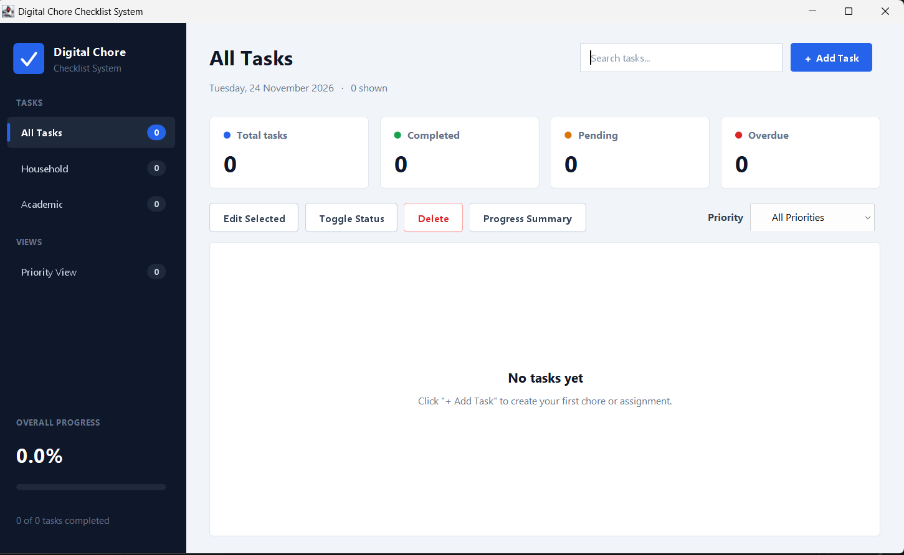

# Digital-Chore-Checklist-System
**Description:** Development of a Java-based Digital Chore Checklist System for Monitoring Household Members and Student Responsibilities
## Project Description
 Managing household chores and student responsibilities can be challenging, especially when multiple people have their own routines and tasks for the day. Some people usually forget their tasks because of their busy schedules, time management, and poor organization. Methods such as written checklists tend to be more difficult to manage because people sometimes forget what they have already done and what they still need to accomplish.

The proposed system aims to provide convenient and organized daily task management, where users can monitor and familiarize themselves with their progress and responsibilities. It fosters accountability and encourages household members and students to establish better management habits.
 


## Problem being address
The project addresses the difficulties in managing household chores and student responsibilities, particularly when individuals have multiple tasks and busy daily schedules.

The use of traditional written checklists can make task management difficult because users may forget their completed tasks and the responsibilities they still need to accomplish.

The system aims to address these problems by providing a digital checklist for organizing, monitoring, and managing daily responsibilities.


## Project Objectives
### General Objective:
 To develop a Java-based Digital Chore Checklist System for monitoring household members' and students' daily responsibilities.

#### Specific Objectives:

1. Identify common challenges in managing and monitoring daily responsibilities.

2. Determine the necessary features and functionalities of the system.

3. Design and develop a digital system for task assignment, scheduling, monitoring, and reporting.

4. Evaluate the system in terms of functionality, usability, reliability, efficiency, and user satisfaction.

5. Determine differences between household members' and students' assessments of the system.


## Target Users
### Household Members
- **Add household chores.**

- **View their household chores.**

- **Update their assigned chores.**

- **Mark their household chores as completed.**

### Students
- **Use the checklist to remember their daily tasks.** 

- **Organize their daily responsibilities.**

- **Monitor their tasks and activities.**


##  Main Features

| Feature | Description |
|---|---|
| Add Task | Allows the user to enter a chore name, description, and schedule. |
| View Checklist | Displays all saved chores and their current status. |
| Mark as Completed | Allows the user to change a chore's status from pending to completed. |
| Update Task | Allows the user to edit the details of an existing chore. |
| Delete Task | Allows the user to remove a chore that is no longer needed. |
| Task Categorization | Distinguishes household and academic tasks. |
| Task Status Monitoring | Allows users to monitor their tasks and activities. |

## Technologies Used


The Digital Chore Checklist System uses the following technologies:

- **Java Programming Language** – Used to develop the system and implement its functionalities.
- **Object-Oriented Programming (OOP)** – Used to organize the program through classes, objects, methods, and OOP principles.
- **GitHub** – Used as the source code repository and for project collaboration.
  ## 8. Team Members and Roles

| Team Member | Role and Responsibilities |
|---|---|
| Cura, Vhenice Joy D. | Project Leader – Coordinates team activities and monitors project completion. |
| Springael, Lance Aixer N. | Develops the Task class, including its attributes, constructors, and methods. |
| Jacinto, Jan Daiho M. | Develops the TaskManager class and the add, view, update, and delete functionalities. |
| Cruzat, Marjon R. | Develops the main menu, user input, and program flow; helps integrate the classes. |
| Oliva, Raquelyn Mae L. | Tests and debugs the system; prepares documentation, screenshots, and presentation. |

## OOP Concepts Demonstrated


####  OOP Concepts Demonstrated

The Digital Chore Checklist System demonstrates the fundamental Object-Oriented Programming (OOP) concepts through its classes, objects, attributes, and methods.

#### 1. Encapsulation

Encapsulation is implemented by keeping the attributes of each task private and accessing or modifying them through public getter and setter methods. This protects task information from unauthorized or unintended changes.

```java
public class Task {
    private String taskName;
    private String description;
    private String dueDate;
    private String status;

    public String getTaskName() {
        return taskName;
    }

    public void setTaskName(String taskName) {
        this.taskName = taskName;
    }

    public String getStatus() {
        return status;
    }

    public void setStatus(String status) {
        this.status = status;
    }
}
```

#### 2. Inheritance

Inheritance is demonstrated through the `HouseholdTask` and `StudentTask` classes, which extend the parent `Task` class. They inherit common task attributes and methods while having their own specific properties.

```java
public class HouseholdTask extends Task {
    private String area;
    private String priority;
}

public class StudentTask extends Task {
    private String subject;
    private String type;
}
```

#### 3. Polymorphism

Polymorphism allows different types of tasks to use the same method name but provide different implementations. For example, household tasks and student tasks can display their own task details by overriding the `getDetails()` method.

```java
public class Task {
    public String getDetails() {
        return "General Task Information";
    }
}

public class HouseholdTask extends Task {
    @Override
    public String getDetails() {
        return "Household Task Information";
    }
}

public class StudentTask extends Task {
    @Override
    public String getDetails() {
        return "Student Task Information";
    }
}
```

#### 4. Abstraction

Abstraction is demonstrated through the `TaskManager` class, which provides simple methods for managing tasks while hiding the internal processes involved in adding, viewing, updating, and deleting tasks.

```java
public class TaskManager {

    public void addTask(Task task) {
        // Handles adding a task
    }

    public void viewAllTasks() {
        // Handles displaying all tasks
    }

    public void updateTask(int index) {
        // Handles updating a task
    }

    public void deleteTask(int index) {
        // Handles deleting a task
    }
}
```

#### 5. Classes and Objects

The system uses classes as blueprints for creating objects. Each task is represented by a `Task`, `HouseholdTask`, or `StudentTask` object containing its own information.

```java
HouseholdTask household = new HouseholdTask();
StudentTask student = new StudentTask();
```

#### 6. Methods

Methods are used to perform the different operations of the system, including adding, viewing, updating, deleting, and marking tasks as completed.

```java
taskManager.addTask(task);
taskManager.viewAllTasks();
taskManager.updateTask(index);
taskManager.deleteTask(index);
```

#### 7. Exception Handling

Exception handling helps prevent the program from terminating unexpectedly when users enter invalid information or make incorrect menu selections.

```java
try {
    int choice = scanner.nextInt();
} catch (Exception e) {
    System.out.println("Invalid input. Please try again.");
}
```

#### 8. Arrays and Data Handling

The system uses an array of `Task` objects to store and organize household and academic tasks. This allows the application to access, display, search, update, and manage the checklist.

```java
Task[] tasks = new Task[100];
int taskCount = 0;

tasks[taskCount] = new HouseholdTask();
taskCount++;
```


##  Instructions for Running

### Requirements
- Java Development Kit (JDK) installed
- Java compiler (`javac`) available in the system PATH
- Windows operating system (to use `run.bat`)

### Steps
1. Download or clone this repository.
2. Open the project folder.
3. Double-click `run.bat`, or run it from Command Prompt.
4. The batch file will compile the Java source files and launch the application.
5. If compilation fails, check that the JDK is installed and that the source files are correctly organized.


   
##  Sample Screenshots

The following screenshots show the interface and main functionalities of the Digital Chore Checklist System. They demonstrate how users can manage their daily household chores and student responsibilities through the application.

#### 11.1 Main Interface

This screenshot shows the main interface of the Digital Chore Checklist System, where users can access the available task management options.



#### 11.2 Add Task

This feature allows users to add new tasks by providing the necessary task details.


#### 11.3 Task List

This screenshot displays the list of saved tasks, allowing users to view and monitor their responsibilities.


#### 11.4 Task Status Completion

This feature allows users to monitor task progress by identifying which tasks are pending and which have already been completed.


#### 11.5 Sorting Tasks and Priority

This screenshot demonstrates how tasks are organized according to their sorting and priority settings.


##  Known Limitations

The Digital Chore Checklist System has the following limitations:

#### 12.1 Console-Based Application
The system only runs as a Java console-based application and does not include a graphical user interface (GUI).

#### 12.2 No User Registration or Login
The system does not support user registration or login accounts.

#### 12.3 No Automatic Notifications or Reminders
The application does not provide automatic notifications or reminders for scheduled chores.

#### 12.4 No Online Storage or Cloud Synchronization
The system does not support online storage or cloud synchronization.

#### 12.5 Limited Task Management
The system focuses on adding, viewing, updating, deleting, and tracking daily household chores and responsibilities.

##  Future Improvements

The following improvements may be considered for future development to enhance the functionality and usability of the Digital Chore Checklist System.

#### 13.1 Graphical User Interface (GUI)
Develop a user-friendly graphical interface to make the application easier to navigate and use.

#### 13.2 User Registration and Login
Add user accounts and authentication to allow different household members and students to manage their own responsibilities.

#### 13.3 Automatic Notifications and Reminders
Implement notifications and reminders to help users remember their scheduled tasks and deadlines.

#### 13.4 Online Storage and Cloud Synchronization
Introduce online storage to allow users to access and synchronize their task information across multiple devices.

#### 13.5 Enhanced Task Management
Expand the system with additional task management options and functionalities to improve organization, monitoring, and productivity.

##  Project Contributors

The Digital Chore Checklist System was developed by Team 1, Group 1, from Section IT-2109 as part of the OOP 101 – Object-Oriented Programming course.

#### 14.1 Team Members and Roles

1. **Cura, Vhenice Joy D.** – Project Leader; coordinates tasks and checks project completion.

2. **Springael, Lance Aixer N.** – Develops the Task class, including its attributes, constructors, and methods.

3. **Jacinto, Jan Daiho M.** – Develops the TaskManager class and the add, view, update, and delete functionalities.

4. **Cruzat, Marjon R.** – Develops the main menu, user input, and program flow; assists with class integration.

5. **Oliva, Raquelyn Mae L.** – Handles system testing and debugging, documentation, screenshots, and presentation.

#### 14.2 Acknowledgment

We would like to acknowledge the contributions and efforts of every team member in planning, developing, testing, and documenting the Digital Chore Checklist System.
